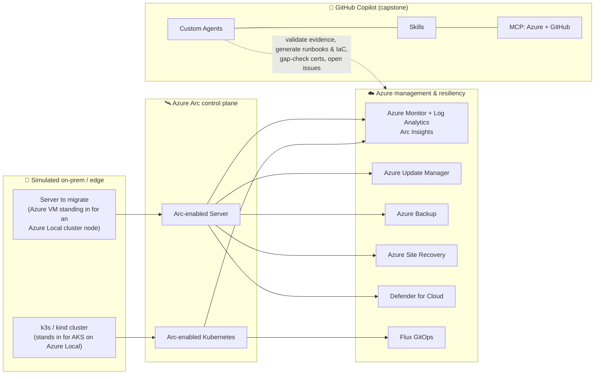

<!-- markdownlint-disable MD041 -->
<div align="center">

# 🛰️ MicroHack — Hybrid Cloud Infrastructure with Microsoft Azure Local

**Module B · 1-Day Classroom-Led Hands-On Lab · Train-the-Trainer**

[](LICENSE)
[](https://codespaces.new/NikoMix/microhack-hybrid-claud-azure-hci?quickstart=1)
[](https://azure.github.io/Azure-Verified-Modules/)
[](.github/agents)

*Take partners from an ageing on-prem datacentre to an Azure Arc–governed hybrid estate — then let GitHub Copilot custom agents drive Module B audit readiness.*

</div>

---

## 🌟 What this is

A complete, instructor-ready **1-day microhack** that teaches the technical and business substance behind the **Hybrid Cloud Infrastructure with Microsoft Azure Local Advanced Specialization — Module B** (controls **B.1.1 → B.4.2**), and demonstrates the latest Azure hybrid capabilities **plus** GitHub Copilot **custom agents, skills, and MCP servers**.

It is built **Train-the-Trainer**: every challenge ships a student `README.md` **and** a `trainer-notes.md` with timing, talk tracks, demo scripts, pitfalls, and checkpoint answers — so you can pick it up and deliver it cold.

> [!NOTE]
> **Focus:** the Microsoft **Azure** control plane and the **migration journey to it**. Azure Local needs validated physical hardware to deploy a real cluster, which doesn't fit a classroom — so pupils **Arc-onboard a normal server and operate it with the exact same Azure services** (Monitor, Update Manager, Backup, ASR, Defender, AKS-on-Arc) that govern a production Azure Local cluster. The physical cluster is treated as pre-built / conceptual.

## 🏗️ Lab architecture



## 🎯 Module B coverage

| Control | Title | Where it's covered |
|---|---|---|
| **B.1.1** | Azure Local Implementation Capability | [01](challenge-01-arc-foundations/) · [02](challenge-02-observability/) · [03](challenge-03-resiliency/) · [04](challenge-04-aks-arc/) |
| **B.2.1** | ACR Performance | [05](challenge-05-specialization-readiness/) (+ eligible services in 02/03/04) |
| **B.2.2** | Customer Diversity | [05](challenge-05-specialization-readiness/) |
| **B.3.1** | Certifications | [05](challenge-05-specialization-readiness/) + appendix |
| **B.4.1** | Audit Readiness | [05](challenge-05-specialization-readiness/) + [06](challenge-06-ai-capstone/) |
| **B.4.2** | Partner Onboarding Assets | [02](challenge-02-observability/)/[03](challenge-03-resiliency/)/[04](challenge-04-aks-arc/) runbooks + [06](challenge-06-ai-capstone/) |

## 🗓️ Agenda (one day)

| Time | Block | Challenge |
|---|---|---|
| 09:00 | Welcome · the Contoso migration story · architecture | — |
| 09:20 | Setup & Foundations | [00 — Setup](challenge-00-setup/) |
| 10:05 | On-prem → Azure-managed hybrid: Azure Local & Arc | [01 — Arc foundations](challenge-01-arc-foundations/) |
| 11:15 | Hybrid observability & lifecycle | [02 — Observability](challenge-02-observability/) |
| 13:00 | Hybrid resiliency: Backup, DR & security | [03 — Resiliency](challenge-03-resiliency/) |
| 14:00 | Modern workloads: AKS enabled by Azure Arc & GitOps | [04 — AKS on Arc](challenge-04-aks-arc/) |
| 15:10 | Specialization readiness: ACR, diversity, certs, audit | [05 — Readiness](challenge-05-specialization-readiness/) |
| 16:00 | **AI capstone:** the Hybrid Cloud Copilot | [06 — AI capstone](challenge-06-ai-capstone/) |
| 17:15 | Debrief · teardown · Train-the-Trainer wrap | — |

Full timing and facilitation: **[docs/agenda.md](docs/agenda.md)** · **[docs/trainer-guide.md](docs/trainer-guide.md)**.

## 🚀 Quick start (pupil)

1. **[Open in GitHub Codespaces](https://codespaces.new/NikoMix/microhack-hybrid-claud-azure-hci?quickstart=1)** (or *Use this template* → your repo → open a Codespace). The devcontainer installs Azure CLI, Terraform + tflint, kubectl/helm, Flux, the GitHub Copilot CLI, and the MCP servers automatically.
2. Sign in to Azure:

   ```bash
   az login --use-device-code
   az account set --subscription "<YOUR_SUBSCRIPTION_ID>"
   ```

3. Start with **[challenge-00-setup](challenge-00-setup/)** and work through the challenges in order.
4. For the capstone, open **Copilot Chat → Agents** and pick a custom agent (e.g. *Hybrid Cloud Architect*).

## ✅ Prerequisites

- A **GitHub account** with **Copilot** enabled (for the agents/skills/MCP capstone).
- An **Azure subscription** where you hold **Owner** (you'll register resource providers and assign RBAC).
- Intermediate Azure familiarity (≈ AZ-104). No local installs — everything runs in Codespaces.

See **[docs/prerequisites.md](docs/prerequisites.md)** and the **[cost estimate & guardrails](docs/cost-estimate.md)**.

## 🤖 The AI capstone — Copilot custom agents, skills & MCP

The finale wires GitHub Copilot into the hybrid estate you just built:

- **Custom agents** in [`.github/agents/`](.github/agents/) — e.g. *Hybrid Cloud Architect*, *Module B Audit Agent*, *Arc Onboarding Copilot*.
- **Skills** in [`.github/skills/`](.github/skills/) — evidence validation, runbook generation, ACR-eligibility mapping, certification gap-checking, Terraform/AVM authoring.
- **MCP servers** in [`.vscode/mcp.json`](.vscode/mcp.json) — the **Azure MCP** server and the **GitHub MCP** server.

Pupils drive the agents to **validate the Module B evidence package, generate operational runbooks and onboarding packs, refine Terraform, gap-check certifications, and open GitHub Issues for any gaps** — AI orchestrated, human governed.

## 📁 Repository structure

```text
.devcontainer/        Codespaces image + toolchain bootstrap
.github/              Copilot agents, skills, MCP notes, CI, issue templates
.vscode/              Recommended extensions + MCP server config
infra/terraform/      Shared base environment (Terraform + Azure Verified Modules)
docs/                 Train-the-Trainer guide, agenda, facilitation, diagrams, cost, teardown
challenge-00-setup/                       Foundations
challenge-01-arc-foundations/             Azure Local & Arc (B.1.1)
challenge-02-observability/               Monitor, Update Manager, Insights (B.1.1/B.2.1/B.4.2)
challenge-03-resiliency/                  Backup, ASR, Defender (B.1.1/B.2.1/B.4.2)
challenge-04-aks-arc/                     AKS on Arc + GitOps (B.1.1/B.2.1)
challenge-05-specialization-readiness/    ACR, diversity, certs, audit (B.2.1/B.2.2/B.3.1/B.4.1/B.4.2)
challenge-06-ai-capstone/                 Copilot agents + skills + MCP (all controls)
```

## 👩‍🏫 For trainers

This repo is designed to be **delivered, not just read**. Start here:

- **[docs/trainer-guide.md](docs/trainer-guide.md)** — how to run the day end-to-end.
- **[docs/facilitation.md](docs/facilitation.md)** — room setup, pacing, engagement, recovery.
- **[docs/talk-tracks.md](docs/talk-tracks.md)** — narrative spine and per-challenge talking points.
- **[docs/grading-checkpoints.md](docs/grading-checkpoints.md)** — success criteria & checkpoint answers.
- Each challenge's **`trainer-notes.md`** — timing, demo script, pitfalls, Q&A.

## 💸 Cost & cleanup

All lab resources use small/consumption SKUs. **Run teardown at the end of the day** — see **[docs/teardown.md](docs/teardown.md)** or:

```bash
task destroy:base
```

## 🤝 Contributing

Issues and PRs welcome — see [CONTRIBUTING.md](CONTRIBUTING.md). All tooling is open-source (MIT/Apache/BSD); no paid licenses are required to build or run this lab.

## ⚖️ License & disclaimer

Licensed under the [MIT License](LICENSE). This is **partner-enablement training content**. Module B thresholds, eligible services, and certification lists change — **always verify against the current Microsoft-issued Advanced Specialization requirements PDF** before relying on them in a live audit engagement.
