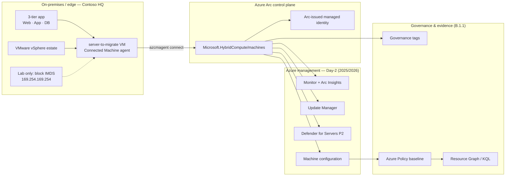

# Challenge 01 — Arc Foundations

Contoso runs a classic **3-tier application** (web, app, database) on an ageing
**VMware vSphere** estate in its Stockholm datacentre. The board has approved a
move to **Azure Local** for the on-premises footprint and **Azure Arc** as the
single control plane across on-premises, edge, and cloud. Before any virtual
machine is migrated, Contoso must prove it can **project an existing server into
Azure**, govern it with **tags and policy**, and **inventory** it centrally. In
this challenge you Arc-enable the base *server-to-migrate* VM and lay the
governance foundation the rest of Module B builds on.



> [!NOTE]
> Production **Azure Local** runs on Microsoft **validated hardware** with
> **Storage Spaces Direct** for software-defined storage, **Network ATC** for
> intent-based host networking, and optional **stretched / site-aware** clusters
> for resilience. This lab does not deploy that hardware; it focuses on the **Arc
> control plane** that governs both Azure Local and any off-Azure server. See the
> diagram source in [`assets/reference-architecture.drawio`](./assets/reference-architecture.drawio).

## 🎯 Objectives

By the end of this challenge, you will be able to:

- Explain the Azure Local platform (validated hardware, Storage Spaces Direct,
  Network ATC, stretched/site-aware clusters) and the Arc control plane.
- Onboard an existing server to **Azure Arc-enabled servers** with a
  least-privilege service principal, using the lab **IMDS-block** technique.
- Apply a consistent **governance tag** set to the Arc machine.
- Assign the guest-configuration **compute security baseline** Azure Policy with
  Terraform, scoped to include Arc machines.
- **Inventory** the Arc estate with Azure Resource Graph (KQL).

## 🧩 Module B coverage

| Control | Evidence created in this challenge |
| --- | --- |
| B.1.1 | The *server-to-migrate* is projected as `Microsoft.HybridCompute/machines`, tagged for governance, placed under a guest-configuration policy assignment, and captured in an Azure Resource Graph inventory export. |
| B.4.2 | A reusable partner [onboarding runbook](./assets/onboarding-runbook.md) generalised from the hands-on steps. |

> [!NOTE]
> Verify the exact current specialization thresholds (e.g. minimum Arc-enabled
> server counts or coverage percentages) in the **Microsoft-issued Advanced
> Specialization requirements PDF**. Numeric thresholds are intentionally **not**
> reproduced here to avoid drift.

## ⏱️ Duration & prerequisites

- Duration: **~60 minutes**.
- Required completed challenges: **Challenge 00** (tooling) and the shared base
  environment deployed from [`infra/terraform/base`](../infra/terraform/base/README.md).
- Required access: Azure subscription **Owner** (needed to create a service
  principal and to assign a policy that carries a managed identity).
- Expected resources: resource group `rg-mhb-<initials>` containing the
  *server-to-migrate* VM (`vm-mhb-<initials>`) reachable over SSH.

> [!TIP]
> The **[Arc Onboarding Copilot](../.github/agents/arc-onboarding-copilot.agent.md)**
> custom agent can generate and explain every command in this challenge, including
> the IMDS-block technique and the Resource Graph verification. Use it as your
> pair-onboarding assistant.

## 🛠️ Tasks

All Azure CLI steps run from **Codespaces** (or any shell with `az`). Steps marked
**on the server** run over SSH on the *server-to-migrate* VM. Replace `<initials>`
with your value throughout.

### Task 0 — Frame the architecture (concepts)

1. Review the reference diagram above and in
   [`assets/reference-architecture.drawio`](./assets/reference-architecture.drawio).
   Be able to explain, in the migration story:
   - **Validated hardware + Storage Spaces Direct** — why Azure Local needs
     certified nodes and software-defined storage.
   - **Network ATC** — intent-based, repeatable host networking.
   - **Stretched / site-aware clusters** — resilience across rooms or sites.
   - **Arc control plane** — one management, policy, and identity plane for
     Azure Local nodes *and* off-Azure servers like Contoso's 3-tier app.

### Task 1 — Register providers and create an onboarding identity

1. Register the required resource providers (idempotent):

   ```bash
   ./scripts/00-register-providers.sh
   ```

1. Create a least-privilege onboarding service principal scoped to the resource
   group. The secret is printed **once** — keep it for Task 3:

   ```bash
   ./scripts/05-create-onboarding-sp.sh <initials>
   ```

### Task 2 — Block IMDS on the server (lab technique)

> [!WARNING]
> Azure VMs cannot normally run the Connected Machine agent because the **Instance
> Metadata Service (IMDS, `169.254.169.254`)** reports them as already in Azure.
> Blocking that endpoint makes the VM present as **off-Azure** so you can practise
> a real Arc onboarding. This is a **classroom-only** technique. The rule is **not**
> persisted across reboot, and you **must reset it** in [Cleanup](#-cleanup).

1. SSH to the server (get the command from the base outputs):

   ```bash
   terraform -chdir=../infra/terraform/base output -raw ssh_command
   ```

1. On the server, block IMDS and confirm it is unreachable:

   ```bash
   sudo ./10-imds-guard.sh block
   sudo ./10-imds-guard.sh status
   ```

### Task 3 — Onboard the server to Azure Arc

1. On the server, paste the `export ARC_*` block printed by Task 1, then connect.
   `sudo -E` preserves those variables for the agent:

   ```bash
   sudo -E ./20-arc-onboard.sh
   ```

1. Confirm the agent reports **Connected**:

   ```bash
   sudo azcmagent show
   ```

1. From Codespaces, confirm Azure now sees the machine:

   ```bash
   az connectedmachine show -g rg-mhb-<initials> -n vm-mhb-<initials> \
     --query '{name:name, status:status, agentVersion:agentVersion}' -o table
   ```

### Task 4 — Apply governance tags

1. Tag the Arc machine and trigger an on-demand compliance scan:

   ```bash
   ./scripts/30-apply-governance.sh <initials>
   ```

### Task 5 — Assign the guest-configuration policy (Terraform)

1. Assign the **compute security baseline** guest-configuration policy, scoped to
   include Arc machines. This uses the AVM-first Terraform module under
   [`infra/`](./infra/README.md):

   ```bash
   export ARM_SUBSCRIPTION_ID="$(az account show --query id -o tsv)"
   terraform -chdir=infra init
   terraform -chdir=infra apply -var "initials=<initials>"
   ```

1. Note the assignment's managed-identity principal id from the output — it is
   used by guest configuration to run audits:

   ```bash
   terraform -chdir=infra output policy_assignment_principal_id
   ```

### Task 6 — Inventory with Azure Resource Graph

1. Run the inventory query from [`assets/arc-inventory.kql`](./assets/arc-inventory.kql)
   (replace `<initials>` inside the query first):

   ```bash
   az graph query -q "resources | where type =~ 'microsoft.hybridcompute/machines' | where resourceGroup =~ 'rg-mhb-<initials>' | project name, location, resourceGroup, tags" -o table
   ```

1. Confirm the governance tags applied in Task 4 appear on the machine.

## ✅ Success criteria

- [ ] Required resource providers are **Registered** in the subscription.
- [ ] `sudo azcmagent show` on the server reports **Connected**.
- [ ] `az connectedmachine show` returns the machine with a current agent version.
- [ ] The Arc machine carries the governance tags (`Datacenter`, `Workload`,
      `Environment`, `ManagedBy`, `ModuleBControl`, …).
- [ ] `terraform -chdir=infra apply` created the guest-configuration policy
      assignment with a system-assigned identity.
- [ ] The Azure Resource Graph query lists the machine with its tags.

## 🧹 Cleanup

> [!IMPORTANT]
> If you keep the VM for later challenges, you **must** still remove the IMDS
> block, otherwise the VM cannot reach Azure services it legitimately needs.

Keep these resources for later challenges:

- The Arc-enabled *server-to-migrate* machine and the guest-configuration policy
  (used as evidence and extended in later challenges).

Reset the lab-only change now, on the server:

```bash
sudo ./10-imds-guard.sh unblock
sudo ./10-imds-guard.sh status
```

To fully reset Challenge 01 between cohorts, run the reset helper (removes the Arc
machine and onboarding service principal) and destroy the policy module:

```bash
./scripts/90-reset.sh <initials>
terraform -chdir=infra destroy -var "initials=<initials>"
```

End-of-day cleanup of all shared resources is covered in
[../docs/teardown.md](../docs/teardown.md).

## 📚 References

- [Azure Arc-enabled servers overview](https://learn.microsoft.com/azure/azure-arc/servers/overview)
- [Connect machines at scale using a service principal](https://learn.microsoft.com/azure/azure-arc/servers/onboard-service-principal)
- [Azure Arc gateway](https://learn.microsoft.com/azure/azure-arc/servers/arc-gateway)
- [Azure Update Manager](https://learn.microsoft.com/azure/update-manager/overview)
- [Machine configuration (guest configuration) overview](https://learn.microsoft.com/azure/governance/machine-configuration/overview)
- [Azure Resource Graph query language](https://learn.microsoft.com/azure/governance/resource-graph/concepts/query-language)
- [What is Azure Local?](https://learn.microsoft.com/azure/azure-local/overview)
- [Network ATC overview](https://learn.microsoft.com/azure/azure-local/concepts/network-atc-overview)
