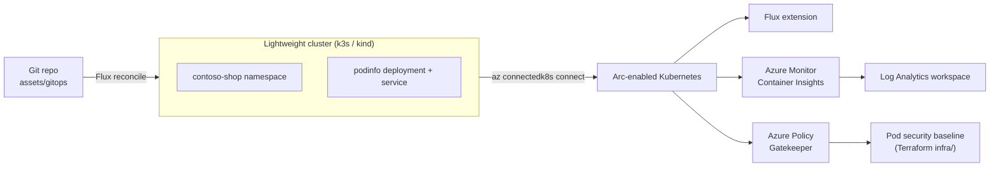

# Challenge 04 — Modern Workloads: AKS enabled by Azure Arc & GitOps

Contoso's datacentre team can already see and govern their *servers* through Azure
Arc (Challenges 01–03). Now the application teams want the same single control
plane for their **Kubernetes** workloads. In this challenge you stand up a small,
license-free cluster, project it into Azure as **Arc-enabled Kubernetes**, and
drive its desired state with **Flux GitOps** — exactly the operating model used
for **AKS enabled by Azure Arc** on Azure Local, without needing physical
hardware. You then light up **Azure Monitor for containers** and **Azure Policy
for Kubernetes** so the cluster is observed and governed from day one.

## 🎯 Objectives

By the end of this challenge, you will be able to:

- Stand up a lightweight Kubernetes cluster (k3s or kind) that runs in
  Codespaces or on the base "server-to-migrate" VM.
- Connect the cluster to Azure as an **Arc-enabled Kubernetes** resource with
  `az connectedk8s connect`.
- Configure **GitOps with Flux v2** so a Git repository becomes the single source
  of truth for the cluster's workloads.
- Enable **Azure Monitor for containers** and **Azure Policy for Kubernetes** as
  Arc cluster extensions.
- Assign a **pod security baseline** policy with Terraform and capture evidence
  of reconciliation and compliance.

## 🧩 Module B coverage

| Control | Evidence created in this challenge |
| --- | --- |
| B.1.1 | An Arc-enabled Kubernetes cluster governed through the Azure control plane — GitOps reconciliation, Monitor, and Policy extensions all visible in Azure. |
| B.2.1 | Eligible Azure consumption is driven (Arc-enabled Kubernetes, Azure Monitor/Log Analytics ingestion, Azure Policy) — the workload signal that underpins ACR performance. |

> [!NOTE]
> Verify exact current specialization thresholds in the Microsoft-issued Advanced
> Specialization requirements PDF. This challenge produces *evidence*, not a
> numeric score.

## ⏱️ Duration & prerequisites

- Duration: `~60 minutes`.
- Required completed challenges: [Challenge 00](../challenge-00-setup/)
  (toolchain and base environment).
  [Challenge 01](../challenge-01-arc-foundations/) is
  recommended for Arc context but not required.
- Required access: Azure subscription **Owner** (provider registration + Arc +
  policy assignment are subscription/RG-level actions).
- Expected resource group: `rg-mhb-<initials>` with the shared Log Analytics
  workspace `log-mhb-<initials>` (from the base deployment).
- A **public HTTPS Git URL** Flux can read (this repo's URL works; a public fork
  is ideal).

> [!TIP]
> **Where to run.** k3s on the base VM is the most representative path (Arc agent
> uses outbound 443). kind in Codespaces also works when a Docker daemon is
> available. All `az` steps run identically from either location once your
> `KUBECONFIG` points at the target cluster.



## 🛠️ Tasks

> [!IMPORTANT]
> Every command below is wrapped by an **idempotent** helper in
> [`scripts/`](scripts/). Run the script for hands-free setup, or copy the inline
> command to learn the API. Replace `<abc>` with your initials throughout.

### Task 1 — Stand up a lightweight Kubernetes cluster

1. Create the cluster (k3s by default; pass `--engine kind` in Docker-capable
   environments):

   ```bash
   ./scripts/00-create-cluster.sh --engine k3s
   ```

1. Validate the node is Ready:

   ```bash
   kubectl get nodes -o wide
   ```

### Task 2 — Connect the cluster to Azure Arc

1. Register providers and connect (the script also installs the `connectedk8s`
   CLI extension):

   ```bash
   ./scripts/01-connect-arc.sh --initials <abc>
   ```

   Equivalent core command:

   ```bash
   az connectedk8s connect \
     --resource-group rg-mhb-<abc> \
     --name arck8s-mhb-<abc>-04 \
     --location swedencentral
   ```

1. Confirm the cluster shows as **Connected**:

   ```bash
   az connectedk8s show -g rg-mhb-<abc> -n arck8s-mhb-<abc>-04 \
     --query '{name:name, state:connectivityStatus}' -o table
   ```

### Task 3 — Configure GitOps with Flux

1. Point Flux at the sample manifests in [`assets/gitops/`](assets/gitops/)
   (namespace + podinfo deployment + service). Use your repo's HTTPS URL:

   ```bash
   ./scripts/02-bootstrap-flux.sh \
     --initials <abc> \
     --git-url https://github.com/<you>/microhack-hybrid-claud-azure-hci.git
   ```

   Equivalent core command:

   ```bash
   az k8s-configuration flux create \
     --resource-group rg-mhb-<abc> \
     --cluster-name arck8s-mhb-<abc>-04 \
     --cluster-type connectedClusters \
     --name gitops-mhb-<abc>-04 \
     --namespace flux-system --scope cluster \
     --url https://github.com/<you>/microhack-hybrid-claud-azure-hci.git \
     --branch main \
     --kustomization name=contoso-shop path=./challenge-04-aks-arc/assets/gitops prune=true \
     --interval 1m
   ```

1. Watch Flux reconcile the workload onto the cluster:

   ```bash
   kubectl get pods -n contoso-shop -w
   ```

### Task 4 — Enable Azure Monitor & Azure Policy

1. Install both cluster extensions (Container Insights → shared workspace, plus
   the Azure Policy add-on):

   ```bash
   ./scripts/03-enable-monitor-policy.sh --initials <abc>
   ```

1. Confirm the extensions are installed and provisioned:

   ```bash
   az k8s-extension list -g rg-mhb-<abc> -c arck8s-mhb-<abc>-04 \
     -t connectedClusters \
     --query '[].{name:name, type:extensionType, state:provisioningState}' -o table
   ```

### Task 5 — Assign the pod security baseline & capture evidence

1. Apply the supporting cloud resources (Container Insights DCR + pod security
   baseline policy assignment) from [`infra/`](infra/):

   ```bash
   cd infra
   cp terraform.tfvars.example terraform.tfvars   # set initials = "<abc>"
   terraform init
   terraform apply
   cd ..
   ```

1. Capture the evidence artifacts requested by the trainer into
   [`assets/evidence/`](assets/evidence/) (see its
   [README](assets/evidence/README.md) for the exact commands), for example:

   ```bash
   kubectl get pods -n contoso-shop -o wide > assets/evidence/workload-pods.txt
   az policy state summarize -g rg-mhb-<abc> -o json > assets/evidence/policy-compliance.json
   ```

## ✅ Success criteria

- [ ] Kubernetes cluster is reachable with `kubectl` (node is `Ready`).
- [ ] Cluster is connected to Azure as **Arc-enabled Kubernetes**
      (`connectivityStatus = Connected`).
- [ ] Flux GitOps configuration is applied and the `contoso-shop` workload is
      reconciled and running.
- [ ] Azure Monitor and Azure Policy extensions show `Succeeded`.
- [ ] Pupil can show reconciliation status and explain the relationship to **AKS
      enabled by Azure Arc**.

## 🧹 Cleanup

Keep these resources for the rest of the day if you plan to revisit GitOps in the
capstone; otherwise tear down the per-challenge resources now:

```bash
# Remove Flux config, extensions, the Arc connection, and the local cluster:
./scripts/99-cleanup.sh --initials <abc> --yes

# Remove the Terraform-managed DCR + policy assignment:
terraform -chdir=infra destroy
```

Keep for later challenges:

- The shared resource group `rg-mhb-<initials>` and Log Analytics workspace
  (owned by the base environment — do **not** delete here).

End-of-day cleanup is covered in [../docs/teardown.md](../docs/teardown.md).

## 📚 References

- [Azure Arc-enabled Kubernetes overview](https://learn.microsoft.com/azure/azure-arc/kubernetes/overview)
- [Connect an existing Kubernetes cluster to Azure Arc](https://learn.microsoft.com/azure/azure-arc/kubernetes/quickstart-connect-cluster)
- [GitOps with Flux v2 for Arc-enabled Kubernetes](https://learn.microsoft.com/azure/azure-arc/kubernetes/conceptual-gitops-flux2)
- [Azure Monitor Container Insights for Arc-enabled Kubernetes](https://learn.microsoft.com/azure/azure-monitor/containers/kubernetes-monitoring-enable)
- [Azure Policy for Kubernetes](https://learn.microsoft.com/azure/governance/policy/concepts/policy-for-kubernetes)
- [Pod Security Admission](https://kubernetes.io/docs/concepts/security/pod-security-admission/)
- [AKS enabled by Azure Arc (Azure Local)](https://learn.microsoft.com/azure/aks/hybrid/aks-overview)
- [podinfo sample application](https://github.com/stefanprodan/podinfo)
