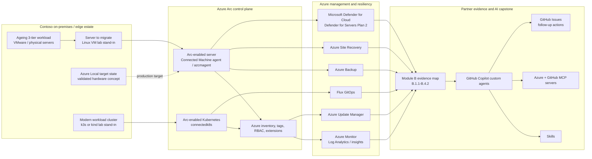
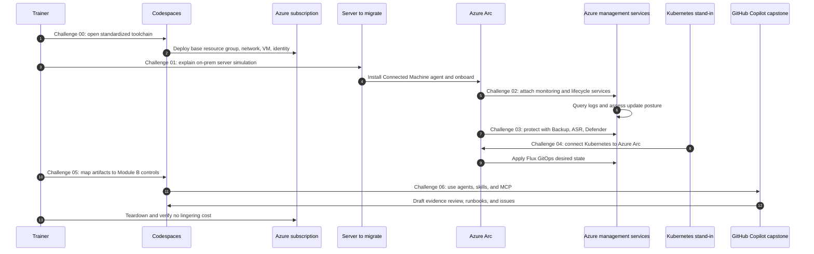

# Architecture deep dive

This page expands the architecture shown in the root [README](../../README.md).
The lab is an Azure-control-plane and migration-focused simulation of the
operating model a partner would use around Azure Local.

> [!NOTE]
> Pupils do not deploy a physical Azure Local cluster in this classroom lab. A
> small Azure VM stands in for a server to migrate, and a lightweight Kubernetes
> environment stands in for modern edge workloads. The learning objective is the
> Azure Arc-governed operating model.

## End-state hybrid architecture

## Migration flow through the day

## Component responsibilities

| Component | Built or used in | Responsibility | Module B relevance |
| --- | --- | --- | --- |
| GitHub Codespaces | Challenge 00 | Standard workstation with Azure CLI, Terraform, kubectl, Helm, Flux, GitHub CLI, quality tools, and Copilot support | Repeatable B.4.2 delivery asset |
| Resource group `rg-mhb-<initials>` | Challenge 00 | Cost and cleanup boundary for each pupil | Supports auditability and teardown discipline |
| VNet, NSG, public IP, NIC | Challenge 00 | Minimal network foundation for the lab VM | Implementation foundation |
| Standard_B2s Linux VM | Challenge 00 | Server-to-migrate stand-in for an on-premises or edge server | B.1.1 implementation story |
| User-assigned managed identity | Challenge 00 | Demonstrates managed identity and RBAC patterns | Secure onboarding pattern |
| Connected Machine agent / `azcmagent` | Challenge 01 | Onboards the server into Azure Arc | Direct B.1.1 evidence |
| Azure Arc-enabled server | Challenge 01 | Azure resource representation of the hybrid server | Governance, inventory, extensions |
| Azure Monitor and Log Analytics | Challenge 02 | Collects signals and supports KQL investigation | Operations proof and B.4.2 runbooks |
| Azure Update Manager | Challenge 02 | Assesses and manages update posture | Lifecycle operations evidence |
| Azure Backup | Challenge 03 | Protects recoverable data points | Resiliency operations evidence |
| Azure Site Recovery | Challenge 03 | Demonstrates disaster recovery readiness concepts | Resiliency and migration discussion |
| Microsoft Defender for Cloud / Defender for Servers Plan 2 | Challenge 03 | Shows security posture and recommendations | Security evidence and customer trust |
| AKS enabled by Azure Arc concept | Challenge 04 | Frames modern workloads on Azure Local or edge | B.1.1 implementation breadth |
| Arc-enabled Kubernetes | Challenge 04 | Connects the classroom Kubernetes stand-in to Azure | Hybrid Kubernetes governance |
| Flux GitOps | Challenge 04 | Applies desired state and creates auditable drift management | Operational repeatability |
| Evidence map | Challenge 05 | Converts lab artifacts into Module B readiness discussion | B.2.1, B.2.2, B.3.1, B.4.1, B.4.2 |
| GitHub Copilot custom agents, skills, MCP | Challenge 06 | Accelerates evidence review, runbook generation, IaC review, and issue creation | Human-governed AI support for all controls |

## How the architecture supports the Module B story

- **B.1.1 Azure Local Implementation Capability:** Challenges 01-04 show how a partner would onboard, operate, protect, and modernize hybrid assets through Azure Arc and Azure management services.
- **B.2.1 ACR Performance:** Challenges 02-04 provide a service-performance discussion surface. Exact eligibility and thresholds must be verified in current official specialization requirements.
- **B.2.2 Customer Diversity:** Challenge 05 translates the technical story into repeatable customer evidence patterns.
- **B.3.1 Certifications:** Challenge 05 reminds trainers to validate current certification requirements rather than relying on stale lists.
- **B.4.1 Audit Readiness:** Challenges 05 and 06 organize artifacts, gaps, and review questions.
- **B.4.2 Partner Onboarding Assets:** Challenges 02, 03, 04, and 06 produce runbooks, evidence notes, and issue-driven follow-up.

## Design constraints and trade-offs

- **No physical Azure Local cluster:** physical hardware is impractical for a one-day classroom. The lab teaches the control-plane pattern that applies to Azure Local.
- **Small SKUs:** Standard_B2s and lightweight Kubernetes keep cost low.
- **Same-day teardown:** Backup, ASR, Defender, disks, and public IPs can create lingering cost.
- **Human-governed AI:** Copilot assists with evidence and operations artifacts; trainers and pupils validate the output.

## Related docs

- [Agenda](../agenda.md)
- [Trainer guide](../trainer-guide.md)
- [Cost estimate](../cost-estimate.md)
- [Troubleshooting](../troubleshooting.md)
- [Teardown](../teardown.md)
